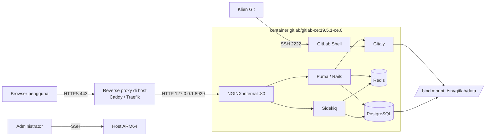

# GitLab CE: Deployment Docker Compose

Laporan Projek Akhir mata kuliah Komunikasi Data dan Jaringan Komputer (KDJK).

| | |
|---|---|
| **Aplikasi web** | GitLab Community Edition (self-hosted) |
| **Metode instalasi** | Docker Compose, image resmi `gitlab/gitlab-ce` |
| **Kelompok** | 5, Paralel P3 |
| **Repositori** | <https://github.com/hamgarian/ProyekKDJK_Kel5_P3> (publik) |
| **URL instance** | <https://gitlab.ilhem.eu.org> (aktif, HTTPS) |
| **Templat laporan** | [templat.md](https://github.com/auriza/komdat-lab/blob/master/templat.md), [projek.md](https://github.com/auriza/komdat-lab/blob/master/projek.md) |

### Anggota Kelompok

| NIM | Nama |
|---|---|
| M0403241083 | Rafid Harsyah Syauqirahman |
| M0403241084 | Melandri Rasya Arindhi |
| M0403241086 | Kevin Daniel Abimanyu Siagian |
| M0403241087 | Ilham Edgar Maulana Goesasi |

---

## Ringkasan Hasil

Instance GitLab CE berjalan di host ARM64 dan dapat diakses publik lewat HTTPS:

| Hal | Hasil |
|---|---|
| Image yang dijalankan | `gitlab/gitlab-ce:19.5.1-ce.0`, varian `linux/arm64` |
| Jalur deployment yang dipakai | Coolify, service Docker Compose langsung ([compose.coolify.yaml](compose.coolify.yaml)) |
| Endpoint | <https://gitlab.ilhem.eu.org> menjawab `HTTP 200` dengan form login GitLab |
| Status service di dalam container | `gitlab-ctl status` menampilkan 10 service berstatus `run:` |
| Reverse proxy dan TLS | Traefik milik Coolify, sertifikat diterbitkan otomatis |

Rincian apa saja yang sudah diverifikasi langsung dan apa yang belum diuji
tercatat di [docs/verifikasi.md](docs/verifikasi.md). Laporan ini tidak
mengklaim hasil uji yang belum dijalankan.

---

## Sekilas Tentang

**GitLab** adalah platform DevOps berbasis web yang menyatukan manajemen
repositori Git, code review, issue tracker, CI/CD, container registry, dan
wiki dalam satu aplikasi. **GitLab Community Edition (CE)** adalah edisi
sumber terbuka berlisensi MIT yang dapat di-*self-host* tanpa biaya lisensi.

Yang membedakan GitLab dari sekadar layanan hosting Git:

- **Satu aplikasi, banyak fungsi.** Repositori, perencanaan (issue, milestone,
  board), code review (merge request), pipeline CI/CD, registry Docker, dan
  GitLab Pages ada dalam satu instalasi, tanpa integrasi pihak ketiga.
- **CI/CD bawaan.** Pipeline didefinisikan di `.gitlab-ci.yml` di dalam
  repositori itu sendiri; runner dapat dijalankan di mesin mana pun.
- **Kedaulatan data.** Seluruh kode, metadata, dan riwayat tersimpan di server
  sendiri. Relevan untuk kode yang tidak boleh keluar dari infrastruktur
  organisasi.
- **Omnibus package.** Satu image/paket sudah memuat seluruh komponen yang
  dibutuhkan: Puma (app server Rails), Sidekiq (background job), PostgreSQL,
  Redis, Gitaly (akses Git), dan NGINX. Tidak perlu merakit tiap komponen.

Pada projek ini GitLab CE dipasang sebagai container Docker tunggal yang
dikelola dengan Docker Compose, dengan TLS diterminasi oleh reverse proxy di
depannya.

## Spesifikasi dan Arsitektur

Seluruh nilai di bawah adalah konfigurasi yang benar-benar dipakai pada host
target, bukan contoh generik.

| Komponen | Konfigurasi yang dipakai |
|---|---|
| Host | `main-instance`, Linux 6.8.0-1058-oracle |
| Arsitektur CPU | **ARM64 (`aarch64`)**, 2 vCPU |
| Memori | 11 GiB RAM + 4 GiB swap |
| Sistem operasi | Ubuntu 22.04 (basis kernel `~22.04.1-Ubuntu`) |
| Docker Engine | 29.0.1 (Community) |
| Aplikasi | `gitlab/gitlab-ce:19.5.1-ce.0` (Omnibus, multi-arch) |
| Komponen dalam container | NGINX, Puma, Sidekiq, PostgreSQL, Redis, Gitaly, GitLab Shell |
| Reverse proxy | Traefik yang dikelola Coolify di host |
| Terminasi TLS | Di reverse proxy, bukan di dalam container |
| Domain | `gitlab.ilhem.eu.org` |
| Port publik | TCP 443 (HTTPS), TCP 2222 (SSH Git) |
| Port internal | container :80, dijangkau Traefik lewat jaringan Docker |
| Persistensi | 3 volume Docker: `gitlab-config`, `gitlab-logs`, `gitlab-data` |

Repositori ini menyediakan dua berkas Compose untuk dua jalur pemasangan yang
keduanya sah, dan isi laporan ini berlaku untuk keduanya:

| Berkas | Jalur | Persistensi | Akses HTTP |
|---|---|---|---|
| [`docker-compose.yml`](docker-compose.yml) | CLI `docker compose` murni, reverse proxy diurus sendiri | 3 bind mount di `./srv/gitlab` | bind `127.0.0.1:8929` |
| [`compose.coolify.yaml`](compose.coolify.yaml) | **jalur yang dipakai pada instance aktif**, ditempel ke service Docker Compose di Coolify | 3 named volume | lewat jaringan Docker ke Traefik |



Pada jalur CLI, port `8929` hanya di-bind ke `127.0.0.1`, sehingga tidak dapat
dijangkau langsung dari internet; satu-satunya jalur HTTP dari luar adalah
melalui reverse proxy yang memegang sertifikat. Pada jalur Coolify, port HTTP
container tidak dipublikasikan ke host sama sekali karena Traefik berada di
jaringan Docker yang sama. Port `2222` harus terbuka langsung pada kedua jalur
karena protokol SSH tidak dapat dilewatkan reverse proxy HTTP. PostgreSQL dan
Redis tidak dipublikasikan sama sekali, keduanya hanya diakses dari dalam
container yang sama.

### Arsitektur Komponen di Dalam Container

```
                         Internet
                            │
                            │  HTTPS :443
                            ▼
              ┌──────────────────────────────┐
              │  Reverse proxy (di host)     │  terminasi TLS,
              │  Caddy / Traefik / Coolify   │  sertifikat Let's Encrypt
              └──────────────┬───────────────┘
                             │  HTTP 127.0.0.1:8929
                             ▼
      ┌──────────────────────────────────────────────┐
      │        container  gitlab/gitlab-ce           │
      │  ┌────────────────────────────────────────┐  │
      │  │ NGINX (internal, :80)                  │  │
      │  └──────┬──────────────────┬──────────────┘  │
      │         ▼                  ▼                 │
      │   ┌──────────┐      ┌─────────────┐          │
      │   │  Puma    │      │  Sidekiq    │          │
      │   │ (Rails)  │      │ (bg jobs)   │          │
      │   └────┬─────┘      └──────┬──────┘          │
      │        └─────────┬─────────┘                 │
      │        ┌─────────┼───────────┬────────────┐  │
      │        ▼         ▼           ▼            ▼  │
      │  ┌──────────┐ ┌───────┐ ┌────────┐ ┌───────┐│
      │  │PostgreSQL│ │ Redis │ │ Gitaly │ │GitLab ││
      │  │          │ │       │ │        │ │ Shell ││
      │  └──────────┘ └───────┘ └────────┘ └───┬───┘│
      └───────────────────────────────────────┬─┴────┘
                                              │ SSH :2222
                                              ▼
                                        git clone via SSH
            volume bind-mount:
              ./srv/gitlab/config  -> /etc/gitlab      (konfigurasi + secrets)
              ./srv/gitlab/logs    -> /var/log/gitlab  (log)
              ./srv/gitlab/data    -> /var/opt/gitlab  (DB, repo, upload, backup)
```

---

## Prasyarat

### Perangkat Lunak

| Komponen | Versi minimum | Catatan |
|---|---|---|
| Linux (Debian/RHEL-based) | - | Docker for Windows **tidak didukung resmi** oleh GitLab |
| Docker Engine | 20.10+ | Pada host target terpasang **29.0.1** |
| Docker Compose | v2 (plugin `docker compose`) | - |
| Reverse proxy | - | Caddy, Traefik, NGINX, atau Coolify |
| MTA (Postfix/Sendmail) | - | **Tidak disertakan** dalam image GitLab; email keluar perlu SMTP eksternal |

### Perangkat Keras

Angka resmi dari dokumentasi GitLab:

| Sumber | CPU | RAM | Storage |
|---|---|---|---|
| [Baseline single-node](https://docs.gitlab.com/install/requirements/) | 8 vCPU | 16 GB | 40 GB (node aplikasi) |
| [Lingkungan terbatas memori](https://docs.gitlab.com/omnibus/settings/memory_constrained_envs/) | 4 core ARM7/ARM64 **atau** 1 core AMD64 | min. 2 GB + 1 GB swap (optimal 2,5 GB + 1 GB) | 20 GB |

Kutipan verbatim dari halaman requirements:

> For a single-node installation, 8 vCPU is the baseline. **ARM-based processors are supported.**

> For single-node installations in memory-constrained environments, GitLab can run with at least 8 GB of memory.

Catatan: halaman requirements menyebut 8 GB sebagai batas bawah
memory-constrained, sedangkan halaman khusus memory-constrained menyebut 2–2,5
GB untuk skenario ≤5 pengembang dengan repositori <100 MB. Projek ini memakai
angka dari halaman khusus tersebut karena skala pemakaiannya sesuai.

### Kondisi Host Target (terukur)

Hasil pengukuran nyata pada host, bukan asumsi:

```console
$ uname -m
aarch64

$ uname -a
Linux main-instance 6.8.0-1058-oracle #61~22.04.1-Ubuntu SMP Tue Jul 14 07:47:31 UTC 2026 aarch64 aarch64 aarch64 GNU/Linux

$ nproc
2

$ free -h
               total        used        free      shared  buff/cache   available
Mem:            11Gi       5.0Gi       146Mi       312Mi       6.5Gi       6.1Gi
Swap:          4.0Gi       4.0Gi       0.0Ki

$ docker version | head -2
Client: Docker Engine - Community
 Version:           29.0.1
```

Yang perlu diperhatikan dari angka di atas:

- **2 vCPU, bukan 4.** Dokumentasi memory-constrained meminta *4 core*
  ARM7/ARM64. Host hanya punya 2. GitLab tetap boot sampai seluruh service
  `run:`, tetapi waktu boot pertama dan latensi request lebih lambat daripada
  angka acuan. Ini risiko kinerja yang diketahui, bukan penghalang.
- **Swap terpakai 100 %** (4,0 GiB dari 4,0 GiB) dan RAM bebas tinggal 146 MiB
  saat pengukuran, karena host juga menanggung beban lain. RAM *available* 6,1
  GiB masih cukup; konfigurasi hemat memori di bagian
  [Konfigurasi](#konfigurasi-hemat-memori) dipilih justru untuk kondisi ini.
- Dokumentasi GitLab menyarankan **menonaktifkan swap** bila memungkinkan
  ("Swap can cause significant performance degradation under load"), sementara
  panduan memory-constrained justru mengandalkan swap. Untuk host 11 GiB ini,
  swap sebaiknya tetap ada tetapi dengan `vm.swappiness=10`.

---

## Arsitektur Host dan Kompatibilitas Image

Host adalah **ARM64 (`aarch64`)**, sehingga kompatibilitas image wajib
diperiksa sebelum apa pun ditulis. Pemeriksaan dilakukan langsung ke Docker Hub
Registry API, bukan berdasarkan ingatan atau tag yang diasumsikan ada.

### Hasil Pemeriksaan Manifest

Perintah yang dipakai (dapat diulang siapa pun):

```sh
TOKEN=$(curl -sS "https://auth.docker.io/token?service=registry.docker.io&scope=repository:gitlab/gitlab-ce:pull" \
        | sed -n 's/.*"token":"\([^"]*\)".*/\1/p')

curl -sS -H "Authorization: Bearer $TOKEN" \
     -H "Accept: application/vnd.docker.distribution.manifest.list.v2+json" \
     -H "Accept: application/vnd.oci.image.index.v1+json" \
     -H "Accept: application/vnd.docker.distribution.manifest.v2+json" \
     "https://registry-1.docker.io/v2/gitlab/gitlab-ce/manifests/19.5.1-ce.0"
```

Hasil per tag (diperiksa 26 Oktober 2026):

| Tag `gitlab/gitlab-ce` | amd64 | arm64 | Bentuk manifest |
|---|---|---|---|
| `17.11.0-ce.0` | ✅ | ❌ | manifest tunggal, **bukan** multi-arch |
| `18.0.0-ce.0` | ✅ | ❌ | manifest tunggal, **bukan** multi-arch |
| `18.1.0-ce.0` | ✅ | ✅ | manifest list |
| `18.2.0-ce.0` … `18.5.1-ce.0` | ✅ | ✅ | manifest list |
| `18.11.13-ce.0` | ✅ | ✅ | manifest list |
| `19.4.3-ce.0` | ✅ | ✅ | manifest list |
| **`19.5.1-ce.0`** ← dipakai | ✅ | ✅ | OCI image index |
| `latest` | ✅ | ✅ | OCI image index |

**Kesimpulan:** dukungan `linux/arm64` resmi pada image `gitlab/gitlab-ce`
muncul mulai **tag `18.1.0-ce.0`**. Tag `18.0.0-ce.0` dan sebelumnya hanya
amd64, sehingga **tidak dapat dipakai di host ini**.

### Tag yang Dipilih

Repositori ini mem-pin **`gitlab/gitlab-ce:19.5.1-ce.0`** dengan digest
terverifikasi:

```
index  (multi-arch) - sha256:bb79dc86267c557fd11e7feb0cd9dd506dd02e991ecdd6cae11ca7d7e5d36fc3
 ├─ linux/amd64     - sha256:939572df24c6517d0408d7355cafef3f7c6defa9d248201151a88361fc411242
 └─ linux/arm64     - sha256:a8adb207a2caeb0bc28d43b3fdfc4963584e8b166dfbc941d0aa9b098e95efe8
```

Digest anak pada `19.5.1-ce.0` identik dengan digest anak pada tag `latest`,
yang mengonfirmasi bahwa `19.5.1-ce.0` adalah rilis stabil terbaru saat
pemeriksaan. Tag di-pin eksplisit (tidak memakai `latest`) sesuai anjuran
dokumentasi GitLab untuk lingkungan produksi.

Verifikasi ini dapat diulang kapan saja dengan:

```sh
./scripts/validate.sh
```

Skrip tersebut membaca tag dari `docker-compose.yml`, mendeteksi arsitektur
host, lalu memastikan tag itu benar-benar menyediakan manifest untuk
arsitektur tersebut - dan **gagal** bila tidak.

### Dari Ketersediaan Artefak ke Bukti Runtime

Ketersediaan manifest arm64 adalah syarat perlu, bukan syarat cukup:
"tag ini punya varian arm64" berbeda dari "image ini benar-benar boot di host
ini". Keduanya kini terpisah jelas dan keduanya sudah terpenuhi. Pemeriksaan
manifest membuktikan yang pertama, dan `gitlab-ctl status` pada container yang
berjalan membuktikan yang kedua:

```console
$ gitlab-ctl status
run: alertmanager: (pid 1234) 0s; run: log: (pid 1230) 0s
run: gitaly: ...
run: gitlab-kas: ...
run: gitlab-workhorse: ...
run: logrotate: ...
run: nginx: ...
run: postgresql: ...
run: puma: ...
run: redis: ...
run: sidekiq: ...
```

Seluruh 10 service berstatus `run:`. Keluaran di atas dirangkum; nilai pid dan
uptime tentu berbeda pada setiap pemeriksaan.

---

