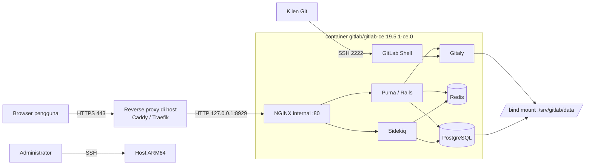

# GitLab CE: Deployment Docker Compose

Laporan Projek Akhir mata kuliah Komunikasi Data dan Jaringan Komputer (KDJK).

| | |
|---|---|
| **Aplikasi web** | GitLab Community Edition (self-hosted) |
| **Metode instalasi** | Docker Compose, image resmi `gitlab/gitlab-ce` |
| **Kelompok** | 5, Paralel P3 |
| **Repositori** | <https://github.com/hamgarian/ProyekKDJK_Kel5_P3> (publik) |
| **URL instance** | <https://gitlab.ilhem.eu.org> (aktif, HTTPS) |
| **Templat laporan** | [templat.md](https://github.com/auriza/komdat-lab/blob/master/templat.md), [projek.md](https://github.com/auriza/komdat-lab/blob/master/projek.md) |

### Anggota Kelompok

| NIM | Nama |
|---|---|
| M0403241083 | Rafid Harsyah Syauqirahman |
| M0403241084 | Melandri Rasya Arindhi |
| M0403241086 | Kevin Daniel Abimanyu Siagian |
| M0403241087 | Ilham Edgar Maulana Goesasi |

---

## Ringkasan Hasil

Instance GitLab CE berjalan di host ARM64 dan dapat diakses publik lewat HTTPS:

| Hal | Hasil |
|---|---|
| Image yang dijalankan | `gitlab/gitlab-ce:19.5.1-ce.0`, varian `linux/arm64` |
| Jalur deployment yang dipakai | Coolify, service Docker Compose langsung ([compose.coolify.yaml](compose.coolify.yaml)) |
| Endpoint | <https://gitlab.ilhem.eu.org> menjawab `HTTP 200` dengan form login GitLab |
| Status service di dalam container | `gitlab-ctl status` menampilkan 10 service berstatus `run:` |
| Reverse proxy dan TLS | Traefik milik Coolify, sertifikat diterbitkan otomatis |

Rincian apa saja yang sudah diverifikasi langsung dan apa yang belum diuji
tercatat di [docs/verifikasi.md](docs/verifikasi.md). Laporan ini tidak
mengklaim hasil uji yang belum dijalankan.

---

## Sekilas Tentang

**GitLab** adalah platform DevOps berbasis web yang menyatukan manajemen
repositori Git, code review, issue tracker, CI/CD, container registry, dan
wiki dalam satu aplikasi. **GitLab Community Edition (CE)** adalah edisi
sumber terbuka berlisensi MIT yang dapat di-*self-host* tanpa biaya lisensi.

Yang membedakan GitLab dari sekadar layanan hosting Git:

- **Satu aplikasi, banyak fungsi.** Repositori, perencanaan (issue, milestone,
  board), code review (merge request), pipeline CI/CD, registry Docker, dan
  GitLab Pages ada dalam satu instalasi, tanpa integrasi pihak ketiga.
- **CI/CD bawaan.** Pipeline didefinisikan di `.gitlab-ci.yml` di dalam
  repositori itu sendiri; runner dapat dijalankan di mesin mana pun.
- **Kedaulatan data.** Seluruh kode, metadata, dan riwayat tersimpan di server
  sendiri. Relevan untuk kode yang tidak boleh keluar dari infrastruktur
  organisasi.
- **Omnibus package.** Satu image/paket sudah memuat seluruh komponen yang
  dibutuhkan: Puma (app server Rails), Sidekiq (background job), PostgreSQL,
  Redis, Gitaly (akses Git), dan NGINX. Tidak perlu merakit tiap komponen.

Pada projek ini GitLab CE dipasang sebagai container Docker tunggal yang
dikelola dengan Docker Compose, dengan TLS diterminasi oleh reverse proxy di
depannya.

## Spesifikasi dan Arsitektur

Seluruh nilai di bawah adalah konfigurasi yang benar-benar dipakai pada host
target, bukan contoh generik.

| Komponen | Konfigurasi yang dipakai |
|---|---|
| Host | `main-instance`, Linux 6.8.0-1058-oracle |
| Arsitektur CPU | **ARM64 (`aarch64`)**, 2 vCPU |
| Memori | 11 GiB RAM + 4 GiB swap |
| Sistem operasi | Ubuntu 22.04 (basis kernel `~22.04.1-Ubuntu`) |
| Docker Engine | 29.0.1 (Community) |
| Aplikasi | `gitlab/gitlab-ce:19.5.1-ce.0` (Omnibus, multi-arch) |
| Komponen dalam container | NGINX, Puma, Sidekiq, PostgreSQL, Redis, Gitaly, GitLab Shell |
| Reverse proxy | Traefik yang dikelola Coolify di host |
| Terminasi TLS | Di reverse proxy, bukan di dalam container |
| Domain | `gitlab.ilhem.eu.org` |
| Port publik | TCP 443 (HTTPS), TCP 2222 (SSH Git) |
| Port internal | container :80, dijangkau Traefik lewat jaringan Docker |
| Persistensi | 3 volume Docker: `gitlab-config`, `gitlab-logs`, `gitlab-data` |

Repositori ini menyediakan dua berkas Compose untuk dua jalur pemasangan yang
keduanya sah, dan isi laporan ini berlaku untuk keduanya:

| Berkas | Jalur | Persistensi | Akses HTTP |
|---|---|---|---|
| [`docker-compose.yml`](docker-compose.yml) | CLI `docker compose` murni, reverse proxy diurus sendiri | 3 bind mount di `./srv/gitlab` | bind `127.0.0.1:8929` |
| [`compose.coolify.yaml`](compose.coolify.yaml) | **jalur yang dipakai pada instance aktif**, ditempel ke service Docker Compose di Coolify | 3 named volume | lewat jaringan Docker ke Traefik |



Pada jalur CLI, port `8929` hanya di-bind ke `127.0.0.1`, sehingga tidak dapat
dijangkau langsung dari internet; satu-satunya jalur HTTP dari luar adalah
melalui reverse proxy yang memegang sertifikat. Pada jalur Coolify, port HTTP
container tidak dipublikasikan ke host sama sekali karena Traefik berada di
jaringan Docker yang sama. Port `2222` harus terbuka langsung pada kedua jalur
karena protokol SSH tidak dapat dilewatkan reverse proxy HTTP. PostgreSQL dan
Redis tidak dipublikasikan sama sekali, keduanya hanya diakses dari dalam
container yang sama.

### Arsitektur Komponen di Dalam Container

```
                         Internet
                            │
                            │  HTTPS :443
                            ▼
              ┌──────────────────────────────┐
              │  Reverse proxy (di host)     │  terminasi TLS,
              │  Caddy / Traefik / Coolify   │  sertifikat Let's Encrypt
              └──────────────┬───────────────┘
                             │  HTTP 127.0.0.1:8929
                             ▼
      ┌──────────────────────────────────────────────┐
      │        container  gitlab/gitlab-ce           │
      │  ┌────────────────────────────────────────┐  │
      │  │ NGINX (internal, :80)                  │  │
      │  └──────┬──────────────────┬──────────────┘  │
      │         ▼                  ▼                 │
      │   ┌──────────┐      ┌─────────────┐          │
      │   │  Puma    │      │  Sidekiq    │          │
      │   │ (Rails)  │      │ (bg jobs)   │          │
      │   └────┬─────┘      └──────┬──────┘          │
      │        └─────────┬─────────┘                 │
      │        ┌─────────┼───────────┬────────────┐  │
      │        ▼         ▼           ▼            ▼  │
      │  ┌──────────┐ ┌───────┐ ┌────────┐ ┌───────┐│
      │  │PostgreSQL│ │ Redis │ │ Gitaly │ │GitLab ││
      │  │          │ │       │ │        │ │ Shell ││
      │  └──────────┘ └───────┘ └────────┘ └───┬───┘│
      └───────────────────────────────────────┬─┴────┘
                                              │ SSH :2222
                                              ▼
                                        git clone via SSH
            volume bind-mount:
              ./srv/gitlab/config  -> /etc/gitlab      (konfigurasi + secrets)
              ./srv/gitlab/logs    -> /var/log/gitlab  (log)
              ./srv/gitlab/data    -> /var/opt/gitlab  (DB, repo, upload, backup)
```

---

## Prasyarat

### Perangkat Lunak

| Komponen | Versi minimum | Catatan |
|---|---|---|
| Linux (Debian/RHEL-based) | - | Docker for Windows **tidak didukung resmi** oleh GitLab |
| Docker Engine | 20.10+ | Pada host target terpasang **29.0.1** |
| Docker Compose | v2 (plugin `docker compose`) | - |
| Reverse proxy | - | Caddy, Traefik, NGINX, atau Coolify |
| MTA (Postfix/Sendmail) | - | **Tidak disertakan** dalam image GitLab; email keluar perlu SMTP eksternal |

### Perangkat Keras

Angka resmi dari dokumentasi GitLab:

| Sumber | CPU | RAM | Storage |
|---|---|---|---|
| [Baseline single-node](https://docs.gitlab.com/install/requirements/) | 8 vCPU | 16 GB | 40 GB (node aplikasi) |
| [Lingkungan terbatas memori](https://docs.gitlab.com/omnibus/settings/memory_constrained_envs/) | 4 core ARM7/ARM64 **atau** 1 core AMD64 | min. 2 GB + 1 GB swap (optimal 2,5 GB + 1 GB) | 20 GB |

Kutipan verbatim dari halaman requirements:

> For a single-node installation, 8 vCPU is the baseline. **ARM-based processors are supported.**

> For single-node installations in memory-constrained environments, GitLab can run with at least 8 GB of memory.

Catatan: halaman requirements menyebut 8 GB sebagai batas bawah
memory-constrained, sedangkan halaman khusus memory-constrained menyebut 2–2,5
GB untuk skenario ≤5 pengembang dengan repositori <100 MB. Projek ini memakai
angka dari halaman khusus tersebut karena skala pemakaiannya sesuai.

### Kondisi Host Target (terukur)

Hasil pengukuran nyata pada host, bukan asumsi:

```console
$ uname -m
aarch64

$ uname -a
Linux main-instance 6.8.0-1058-oracle #61~22.04.1-Ubuntu SMP Tue Jul 14 07:47:31 UTC 2026 aarch64 aarch64 aarch64 GNU/Linux

$ nproc
2

$ free -h
               total        used        free      shared  buff/cache   available
Mem:            11Gi       5.0Gi       146Mi       312Mi       6.5Gi       6.1Gi
Swap:          4.0Gi       4.0Gi       0.0Ki

$ docker version | head -2
Client: Docker Engine - Community
 Version:           29.0.1
```

Yang perlu diperhatikan dari angka di atas:

- **2 vCPU, bukan 4.** Dokumentasi memory-constrained meminta *4 core*
  ARM7/ARM64. Host hanya punya 2. GitLab tetap boot sampai seluruh service
  `run:`, tetapi waktu boot pertama dan latensi request lebih lambat daripada
  angka acuan. Ini risiko kinerja yang diketahui, bukan penghalang.
- **Swap terpakai 100 %** (4,0 GiB dari 4,0 GiB) dan RAM bebas tinggal 146 MiB
  saat pengukuran, karena host juga menanggung beban lain. RAM *available* 6,1
  GiB masih cukup; konfigurasi hemat memori di bagian
  [Konfigurasi](#konfigurasi-hemat-memori) dipilih justru untuk kondisi ini.
- Dokumentasi GitLab menyarankan **menonaktifkan swap** bila memungkinkan
  ("Swap can cause significant performance degradation under load"), sementara
  panduan memory-constrained justru mengandalkan swap. Untuk host 11 GiB ini,
  swap sebaiknya tetap ada tetapi dengan `vm.swappiness=10`.

---

## Arsitektur Host dan Kompatibilitas Image

Host adalah **ARM64 (`aarch64`)**, sehingga kompatibilitas image wajib
diperiksa sebelum apa pun ditulis. Pemeriksaan dilakukan langsung ke Docker Hub
Registry API, bukan berdasarkan ingatan atau tag yang diasumsikan ada.

### Hasil Pemeriksaan Manifest

Perintah yang dipakai (dapat diulang siapa pun):

```sh
TOKEN=$(curl -sS "https://auth.docker.io/token?service=registry.docker.io&scope=repository:gitlab/gitlab-ce:pull" \
        | sed -n 's/.*"token":"\([^"]*\)".*/\1/p')

curl -sS -H "Authorization: Bearer $TOKEN" \
     -H "Accept: application/vnd.docker.distribution.manifest.list.v2+json" \
     -H "Accept: application/vnd.oci.image.index.v1+json" \
     -H "Accept: application/vnd.docker.distribution.manifest.v2+json" \
     "https://registry-1.docker.io/v2/gitlab/gitlab-ce/manifests/19.5.1-ce.0"
```

Hasil per tag (diperiksa 26 Oktober 2026):

| Tag `gitlab/gitlab-ce` | amd64 | arm64 | Bentuk manifest |
|---|---|---|---|
| `17.11.0-ce.0` | ✅ | ❌ | manifest tunggal, **bukan** multi-arch |
| `18.0.0-ce.0` | ✅ | ❌ | manifest tunggal, **bukan** multi-arch |
| `18.1.0-ce.0` | ✅ | ✅ | manifest list |
| `18.2.0-ce.0` … `18.5.1-ce.0` | ✅ | ✅ | manifest list |
| `18.11.13-ce.0` | ✅ | ✅ | manifest list |
| `19.4.3-ce.0` | ✅ | ✅ | manifest list |
| **`19.5.1-ce.0`** ← dipakai | ✅ | ✅ | OCI image index |
| `latest` | ✅ | ✅ | OCI image index |

**Kesimpulan:** dukungan `linux/arm64` resmi pada image `gitlab/gitlab-ce`
muncul mulai **tag `18.1.0-ce.0`**. Tag `18.0.0-ce.0` dan sebelumnya hanya
amd64, sehingga **tidak dapat dipakai di host ini**.

### Tag yang Dipilih

Repositori ini mem-pin **`gitlab/gitlab-ce:19.5.1-ce.0`** dengan digest
terverifikasi:

```
index  (multi-arch) - sha256:bb79dc86267c557fd11e7feb0cd9dd506dd02e991ecdd6cae11ca7d7e5d36fc3
 ├─ linux/amd64     - sha256:939572df24c6517d0408d7355cafef3f7c6defa9d248201151a88361fc411242
 └─ linux/arm64     - sha256:a8adb207a2caeb0bc28d43b3fdfc4963584e8b166dfbc941d0aa9b098e95efe8
```

Digest anak pada `19.5.1-ce.0` identik dengan digest anak pada tag `latest`,
yang mengonfirmasi bahwa `19.5.1-ce.0` adalah rilis stabil terbaru saat
pemeriksaan. Tag di-pin eksplisit (tidak memakai `latest`) sesuai anjuran
dokumentasi GitLab untuk lingkungan produksi.

Verifikasi ini dapat diulang kapan saja dengan:

```sh
./scripts/validate.sh
```

Skrip tersebut membaca tag dari `docker-compose.yml`, mendeteksi arsitektur
host, lalu memastikan tag itu benar-benar menyediakan manifest untuk
arsitektur tersebut - dan **gagal** bila tidak.

### Dari Ketersediaan Artefak ke Bukti Runtime

Ketersediaan manifest arm64 adalah syarat perlu, bukan syarat cukup:
"tag ini punya varian arm64" berbeda dari "image ini benar-benar boot di host
ini". Keduanya kini terpisah jelas dan keduanya sudah terpenuhi. Pemeriksaan
manifest membuktikan yang pertama, dan `gitlab-ctl status` pada container yang
berjalan membuktikan yang kedua:

```console
$ gitlab-ctl status
run: alertmanager: (pid 1234) 0s; run: log: (pid 1230) 0s
run: gitaly: ...
run: gitlab-kas: ...
run: gitlab-workhorse: ...
run: logrotate: ...
run: nginx: ...
run: postgresql: ...
run: puma: ...
run: redis: ...
run: sidekiq: ...
```

Seluruh 10 service berstatus `run:`. Keluaran di atas dirangkum; nilai pid dan
uptime tentu berbeda pada setiap pemeriksaan.

---

## Instalasi

Dua jalur dijelaskan di bawah. Jalur A adalah pemasangan Docker Compose murni
lewat CLI dan dapat diulang di host mana pun. Jalur B adalah jalur yang dipakai
untuk instance aktif `gitlab.ilhem.eu.org`.

### A. Instalasi via CLI (Docker Compose)

#### 1. Pasang Docker Engine dan plugin Compose

```sh
# Ubuntu/Debian - repositori resmi Docker
sudo apt-get update
sudo apt-get install -y ca-certificates curl gnupg
sudo install -m 0755 -d /etc/apt/keyrings
sudo curl -fsSL https://download.docker.com/linux/ubuntu/gpg \
     -o /etc/apt/keyrings/docker.asc
sudo chmod a+r /etc/apt/keyrings/docker.asc

echo "deb [arch=$(dpkg --print-architecture) signed-by=/etc/apt/keyrings/docker.asc] \
https://download.docker.com/linux/ubuntu $(. /etc/os-release && echo $VERSION_CODENAME) stable" \
  | sudo tee /etc/apt/sources.list.d/docker.list > /dev/null

sudo apt-get update
sudo apt-get install -y docker-ce docker-ce-cli containerd.io \
     docker-buildx-plugin docker-compose-plugin
```

Verifikasi, termasuk arsitektur yang dilaporkan Docker:

```sh
docker version
docker compose version
docker info --format '{{.Architecture}} / {{.OSType}}'   # harus: aarch64 / linux
```

#### 2. Siapkan swap dan swappiness

Dokumentasi memory-constrained GitLab mewajibkan swap tersedia **sebelum**
instalasi. Host target sudah punya 4 GiB swap; bila belum:

```sh
sudo fallocate -l 2G /swapfile
sudo chmod 600 /swapfile
sudo mkswap /swapfile
sudo swapon /swapfile
echo '/swapfile none swap sw 0 0' | sudo tee -a /etc/fstab

# Kurangi kecenderungan swap-out
sudo sysctl vm.swappiness=10
echo 'vm.swappiness=10' | sudo tee -a /etc/sysctl.conf

free -h    # pastikan baris Swap terisi
```

#### 3. Ubah port SSH host (agar port 22 bebas untuk GitLab) - opsional

Konfigurasi pada repositori ini **tidak** memakai port 22 host; GitLab Shell
dipetakan ke `2222`. Bila nanti diinginkan URL clone tanpa nomor port,
dokumentasi GitLab menyarankan memindahkan sshd host:

```sh
sudo sed -i 's/^#\?Port .*/Port 2424/' /etc/ssh/sshd_config
sudo systemctl restart ssh
# WAJIB: buka sesi terminal BARU dan uji login sebelum menutup sesi lama
```

#### 4. Ambil repositori dan siapkan `.env`

```sh
git clone https://github.com/hamgarian/ProyekKDJK_Kel5_P3.git
cd ProyekKDJK_Kel5_P3

cp .env.example .env
$EDITOR .env          # sesuaikan GITLAB_HOST dan GITLAB_EXTERNAL_URL
```

#### 5. Siapkan direktori volume

```sh
mkdir -p ./srv/gitlab/config ./srv/gitlab/logs ./srv/gitlab/data
```

#### 6. Validasi konfigurasi sebelum menjalankan apa pun

```sh
./scripts/validate.sh                       # cek repo + kompatibilitas arsitektur
docker compose config                       # cek hasil interpolasi env
```

#### 7. Tarik image dan jalankan

```sh
docker compose pull
docker compose up -d
```

#### 8. Pantau proses boot

Boot pertama GitLab lama - pada 2 vCPU ARM64 realistisnya **10–30 menit**,
karena `gitlab-ctl reconfigure` menjalankan seluruh resep Chef, migrasi basis
data, dan kompilasi aset.

```sh
docker compose logs -f gitlab          # ikuti log reconfigure
docker compose ps                      # tunggu status: healthy
docker compose exec gitlab gitlab-ctl status
```

#### 9. Ambil password root awal

Password root dibuat otomatis pada boot pertama dan **hanya berlaku 24 jam**.

```sh
docker compose exec gitlab \
  grep 'Password:' /etc/gitlab/initial_root_password
```

> Jangan pernah menyalin password ini ke dalam repositori. Segera login dan
> ganti lewat **Edit profile → Password**, lalu hapus berkas
> `initial_root_password`.

### B. Instalasi via Coolify

[Coolify](https://coolify.io) adalah panel PaaS self-hosted yang membungkus
Docker Compose dan Traefik, serta mengurus sertifikat TLS otomatis. Inilah
jalur yang dipakai untuk instance `gitlab.ilhem.eu.org`.

Satu hal yang perlu ditegaskan karena sering disalahpahami: service ini
**bukan** deployment yang tertaut ke repositori GitHub. Tidak ada webhook,
tidak ada build otomatis saat ada commit baru, dan Coolify tidak menarik
berkas Compose dari GitHub. Yang dipakai adalah service **Docker Compose
langsung**, yaitu definisi Compose yang ditempel ke dalam Coolify. Berkas
[`compose.coolify.yaml`](compose.coolify.yaml) di repositori ini adalah salinan
definisi tersebut, disimpan agar konfigurasi instance ikut ter-versi.

1. **Siapkan DNS.** Buat record `A` (atau `AAAA`) untuk `gitlab.ilhem.eu.org`
   yang menunjuk ke alamat IP publik server. Tanpa ini, Traefik tidak dapat
   menyelesaikan tantangan penerbitan sertifikat.

2. **Buat service baru di Coolify.** Dari dashboard: **+ New** →
   **Docker Compose Empty**, lalu pilih server tujuan.

3. **Tempel definisi Compose.** Isi editor Compose dengan isi
   `compose.coolify.yaml`. Perhatikan tiga hal pada berkas itu:

   - `image: gitlab/gitlab-ce:19.5.1-ce.0`, tag yang di-pin dan sudah
     diverifikasi menyediakan `linux/arm64`;
   - tidak ada publikasi port 80/443 ke host, karena Traefik milik Coolify yang
     mengambil peran itu; hanya `2222:22` yang dipublikasikan untuk SSH Git;
   - `mem_limit: 4g` sebagai pagar agar satu container tidak menghabiskan
     memori host.

4. **Isi variabel rahasia.** `compose.coolify.yaml` memakai
   `SERVICE_PASSWORD_GITLABROOT`, yaitu pola variabel *magic* Coolify: panel
   membangkitkan nilai acak dan menyuntikkannya saat deploy, sehingga password
   root awal tidak pernah ditulis di repositori. Nilainya dilihat di tab
   **Environment Variables** service tersebut.

5. **Atur domain.** Pada tab **Domains** untuk service `gitlab`, isi
   `https://gitlab.ilhem.eu.org` dan tetapkan port `80` sebagai port yang
   di-proxy. Coolify menerbitkan sertifikat dan menyuntikkan label Traefik
   secara otomatis, sehingga tidak ada label yang perlu ditulis manual.

6. **Pastikan batas waktu health check cukup panjang.** Default Coolify terlalu
   pendek untuk boot pertama GitLab; `compose.coolify.yaml` memakai
   `start_period: 15m` agar container tidak dibunuh sebelum siap.

7. **Deploy**, lalu pantau log sampai muncul `gitlab Reconfigured!`.

8. **Verifikasi dari dalam container** lewat terminal Coolify:

   ```sh
   gitlab-ctl status          # seluruh service harus run:
   ```

9. **Ambil atau ganti password root.** Bila
   `gitlab_rails['initial_root_password']` dipakai seperti pada berkas ini,
   password berasal dari variabel Coolify, bukan dari
   `/etc/gitlab/initial_root_password`. Gantilah lewat **Edit profile →
   Password** setelah login pertama.

**Hal yang perlu diperhatikan saat memakai Coolify:**

- Coolify sudah menjalankan Traefik pada port 80/443 host, jadi definisi
  Compose tidak boleh meminta kedua port itu. Pada jalur CLI, hal yang sama
  dijaga dengan mem-bind HTTP hanya ke `127.0.0.1:8929`.
- Port SSH `2222` perlu dibuka manual di firewall; Coolify tidak mengurus port
  non-HTTP secara otomatis.
- Jangan mengaktifkan terminasi TLS di dalam container selama proxy eksternal
  dipakai. Nilai `letsencrypt['enable'] = false` dan
  `nginx['listen_https'] = false` pada kedua berkas Compose harus dipertahankan.
- Named volume Coolify (`gitlab-config`, `gitlab-logs`, `gitlab-data`) dikelola
  Docker, bukan bind mount relatif. Untuk backup, isi `gitlab-config` tetap
  harus disalin keluar secara terpisah, lihat
  [Backup dan Restore](#backup-dan-restore).

---

## Konfigurasi

Seluruh konfigurasi GitLab dilakukan lewat variabel `GITLAB_OMNIBUS_CONFIG`
pada `docker-compose.yml`. Isinya adalah baris-baris `gitlab.rb` yang
dituliskan ke `/etc/gitlab/gitlab.rb` lalu diterapkan oleh
`gitlab-ctl reconfigure` setiap container start.

### Konfigurasi Reverse Proxy dan TLS

Pendekatan yang dipakai: **TLS diterminasi di luar container.** NGINX internal
GitLab hanya melayani HTTP di port 80 ke loopback, dan reverse proxy di host
yang memegang sertifikat.

Konfigurasi di dalam container:

```ruby
external_url 'https://gitlab.ilhem.eu.org'
nginx['listen_port'] = 80           # NGINX internal tetap HTTP
nginx['listen_https'] = false       # TLS bukan tugas container
nginx['proxy_set_headers'] = {
  'X-Forwarded-Proto' => 'https',
  'X-Forwarded-Ssl'   => 'on'
}
letsencrypt['enable'] = false       # sertifikat diurus reverse proxy
```

Tiga baris pertama itu penting dan sering terlewat: bila `external_url`
berawalan `https://` tetapi `listen_https` tidak di-`false`, GitLab akan
mencoba melayani TLS sendiri di port 80 dan menghasilkan redirect berulang
(*too many redirects*). Header `X-Forwarded-Proto` diperlukan agar Rails
membangkitkan URL absolut berskema `https`.

#### Opsi 1 - Caddy (paling ringkas)

`/etc/caddy/Caddyfile` di host:

```caddyfile
gitlab.ilhem.eu.org {
    reverse_proxy 127.0.0.1:8929

    # GitLab mengirim berkas besar (artifact, LFS); jangan dibatasi proxy.
    request_body {
        max_size 0
    }
}
```

```sh
sudo caddy validate --config /etc/caddy/Caddyfile
sudo systemctl reload caddy
```

Caddy mengambil sertifikat Let's Encrypt otomatis via HTTP-01/TLS-ALPN,
termasuk perpanjangannya. Tidak ada konfigurasi TLS yang perlu ditulis manual.

#### Opsi 2 - NGINX di host

```nginx
server {
    listen 443 ssl http2;
    server_name gitlab.ilhem.eu.org;

    ssl_certificate     /etc/letsencrypt/live/gitlab.ilhem.eu.org/fullchain.pem;
    ssl_certificate_key /etc/letsencrypt/live/gitlab.ilhem.eu.org/privkey.pem;
    ssl_protocols       TLSv1.2 TLSv1.3;

    client_max_body_size 0;       # jangan batasi; GitLab yang mengatur

    location / {
        proxy_pass http://127.0.0.1:8929;
        proxy_set_header Host              $host;
        proxy_set_header X-Real-IP         $remote_addr;
        proxy_set_header X-Forwarded-For   $proxy_add_x_forwarded_for;
        proxy_set_header X-Forwarded-Proto https;
        proxy_set_header X-Forwarded-Ssl   on;

        proxy_read_timeout  3600;   # operasi Git besar bisa lama
        proxy_connect_timeout 300;
        proxy_http_version 1.1;
    }
}

server {
    listen 80;
    server_name gitlab.ilhem.eu.org;
    return 301 https://$host$request_uri;
}
```

```sh
sudo nginx -t && sudo systemctl reload nginx
```

#### Opsi 3 - Traefik (jalur Coolify)

Coolify menyuntikkan label Traefik sendiri saat domain diisi di UI, jadi
biasanya tidak perlu menulis label manual. Bila Traefik dikelola sendiri:

```yaml
labels:
  - "traefik.enable=true"
  - "traefik.http.routers.gitlab.rule=Host(`gitlab.ilhem.eu.org`)"
  - "traefik.http.routers.gitlab.entrypoints=websecure"
  - "traefik.http.routers.gitlab.tls.certresolver=letsencrypt"
  - "traefik.http.services.gitlab.loadbalancer.server.port=80"
```

#### Verifikasi TLS

```sh
# Resolve DNS
dig +short gitlab.ilhem.eu.org

# Rantai sertifikat dan masa berlaku
echo | openssl s_client -connect gitlab.ilhem.eu.org:443 \
       -servername gitlab.ilhem.eu.org 2>/dev/null \
     | openssl x509 -noout -subject -issuer -dates

# Halaman login lewat HTTPS (harus 200)
curl -sSI https://gitlab.ilhem.eu.org/users/sign_in | head -1
```

Hasil pemeriksaan pada 26 Oktober 2026: permintaan HTTPS ke
`https://gitlab.ilhem.eu.org/users/sign_in` berhasil melalui TLS tanpa
peringatan sertifikat dan menjawab `HTTP 200` dengan halaman login GitLab
(form **Username or email** dan **Password**) sebagai isi respons. Artinya DNS,
penerbitan sertifikat oleh Traefik, dan rantai proxy sampai ke NGINX internal
container bekerja sebagai satu kesatuan.

#### SSH untuk `git clone`

SSH **tidak** melewati reverse proxy HTTP; port TCP 2222 harus terbuka langsung.

```sh
sudo ufw allow 2222/tcp comment 'GitLab Shell SSH'

# Uji dari klien setelah deploy
ssh -T -p 2222 git@gitlab.ilhem.eu.org    # harap muncul: Welcome to GitLab, @username!
```

URL clone akan berbentuk:

```
ssh://git@gitlab.ilhem.eu.org:2222/namagrup/namaprojek.git
```

### Konfigurasi Hemat Memori

Diambil verbatim dari
[Running GitLab in a memory-constrained environment](https://docs.gitlab.com/omnibus/settings/memory_constrained_envs/).
Semua setting berikut sudah aktif di `docker-compose.yml`.

| Setting | Nilai | Efek menurut dokumentasi resmi |
|---|---|---|
| `puma['worker_processes']` | `0` | Matikan clustered mode → **hemat 100–400 MB** |
| `sidekiq['concurrency']` | `10` | Turun dari default 20 |
| `prometheus_monitoring['enable']` | `false` | Matikan seluruh stack monitoring → **hemat ~300 MB** |
| `gitlab_rails['env'] MALLOC_CONF` | `dirty_decay_ms:1000,muzzy_decay_ms:1000` | jemalloc lebih cepat melepas memori |
| `gitaly['env'] MALLOC_CONF` | sama | idem untuk Gitaly |
| `gitaly[...] GITALY_COMMAND_SPAWN_MAX_PARALLEL` | `2` | Batasi proses Git paralel |
| `gitaly['configuration'] concurrency` | `max_per_repo: 3` | Batasi `PostReceivePack` & `SSHUploadPack` |

Konfigurasi gabungan versi dokumentasi resmi:

```ruby
puma['worker_processes'] = 0
sidekiq['concurrency'] = 10
prometheus_monitoring['enable'] = false
gitlab_rails['env'] = {
  'MALLOC_CONF' => 'dirty_decay_ms:1000,muzzy_decay_ms:1000'
}
gitaly['configuration'] = {
  concurrency: [
    {
      'rpc' => "/gitaly.SmartHTTPService/PostReceivePack",
      'max_per_repo' => 3,
    }, {
      'rpc' => "/gitaly.SSHService/SSHUploadPack",
      'max_per_repo' => 3,
    },
  ],
}
gitaly['env'] = {
  'MALLOC_CONF' => 'dirty_decay_ms:1000,muzzy_decay_ms:1000',
  'GITALY_COMMAND_SPAWN_MAX_PARALLEL' => '2'
}
```

Dokumentasi resmi juga menyarankan menonaktifkan **Prometheus Metrics** dari
dalam aplikasi setelah login: **Admin → Settings → Metrics and profiling →
Metrics - Prometheus → nonaktifkan → Save changes**. Langkah ini hanya tersedia
lewat UI dan karena itu tidak dapat diwakili oleh berkas Compose; lakukan
setelah login administratif pertama.

Konsekuensi yang harus disadari - kutipan dokumentasi:

> While most GitLab parts should be functional with these settings in place,
> you may experience unexpected degradation of both product functionality and
> performance.

Dengan `puma['worker_processes'] = 0`, hanya ada **satu** proses Puma. Request
HTTP diproses dengan konkurensi rendah; cocok untuk ≤5 pengembang, tidak cocok
untuk banyak pengguna bersamaan.

### Konfigurasi Batas Upload

```ruby
gitlab_rails['max_attachment_size'] = 50    # MB, batas lampiran di aplikasi
nginx['client_max_body_size'] = '50m'       # batas di NGINX internal
```

Keduanya harus dinaikkan bersamaan - dan reverse proxy di host juga tidak
boleh membatasi (`client_max_body_size 0` pada NGINX, `max_size 0` pada Caddy),
jika tidak, upload besar akan gagal di lapisan proxy sebelum sampai ke GitLab.

### `shm_size`

```yaml
shm_size: '256m'
```

Nilai ini diambil dari contoh resmi `docker-compose.yml` di dokumentasi GitLab.
Default `/dev/shm` Docker hanya 64 MB dan tidak cukup untuk PostgreSQL bawaan
GitLab.

---

## Persistensi Data

GitLab Omnibus menyimpan **semua** state di tiga direktori. Ketiganya
di-*bind mount* ke host agar data bertahan melewati `docker compose down`,
upgrade image, dan restart host.

| Host (relatif terhadap repo) | Container | Isi |
|---|---|---|
| `./srv/gitlab/config` | `/etc/gitlab` | `gitlab.rb`, **`gitlab-secrets.json`**, sertifikat |
| `./srv/gitlab/logs` | `/var/log/gitlab` | log seluruh komponen |
| `./srv/gitlab/data` | `/var/opt/gitlab` | PostgreSQL, repositori Git, upload, artifact, **backup** |

Pemetaan ini sama dengan yang didokumentasikan GitLab, hanya saja dokumentasi
resmi memakai variabel `$GITLAB_HOME` (umumnya `/srv/gitlab`):

```sh
export GITLAB_HOME=/srv/gitlab   # lalu volume: $GITLAB_HOME/config:/etc/gitlab, dst.
```

Jalur CLI pada repositori ini memakai path relatif `./srv/gitlab` supaya satu
direktori projek berisi semuanya tanpa path absolut.

Pada jalur Coolify yang dipakai instance aktif, tiga titik mount yang sama
dipenuhi oleh **named volume** Docker, bukan bind mount:

| Named volume | Container |
|---|---|
| `gitlab-config` | `/etc/gitlab` |
| `gitlab-logs` | `/var/log/gitlab` |
| `gitlab-data` | `/var/opt/gitlab` |

Named volume tetap bertahan melewati `docker compose down` dan redeploy dari
panel, tetapi lokasinya ada di bawah `/var/lib/docker/volumes`. Untuk menyalin
isinya keluar, pakai `docker cp` dari container yang berjalan atau mount volume
tersebut ke container bantu.

### Yang Paling Kritis: `gitlab-secrets.json`

`./srv/gitlab/config/gitlab-secrets.json` memuat kunci enkripsi basis data.
Tanpa berkas ini, backup basis data **tidak dapat didekripsi** - token CI/CD,
variabel terenkripsi, dan 2FA akan hilang permanen meski dump SQL utuh.

Konsekuensinya:

- `gitlab-secrets.json` harus dibackup **terpisah** dari arsip backup biasa,
  karena `gitlab-backup create` **tidak** menyertakannya.
- Berkas ini **tidak boleh** masuk ke repositori Git. Sudah masuk daftar
  `.gitignore`, dan `scripts/validate.sh` ikut memeriksanya.

### Catatan Izin Direktori

Proses di dalam container berjalan sebagai `root`, jadi dengan Docker standar
tidak ada penyesuaian izin. Bila Docker dijalankan dalam mode *rootless* atau
dengan user non-root, dokumentasi GitLab mewajibkan pemberian izin yang sesuai
ke direktori volume lebih dulu.

### Uji Coba Terpisah (tanpa mengganggu volume utama)

Untuk mencoba tag image baru tanpa menyentuh data instance yang sudah berjalan,
pakai nama container dan direktori volume terpisah:

```sh
mkdir -p /tmp/gitlab-smoke/{config,logs,data}
docker run --rm -d --name gitlab-smoke \
  --shm-size 256m \
  -e GITLAB_OMNIBUS_CONFIG="external_url 'http://localhost:8929'; puma['worker_processes'] = 0; prometheus_monitoring['enable'] = false" \
  -p 127.0.0.1:8929:80 \
  -v /tmp/gitlab-smoke/config:/etc/gitlab \
  -v /tmp/gitlab-smoke/logs:/var/log/gitlab \
  -v /tmp/gitlab-smoke/data:/var/opt/gitlab \
  gitlab/gitlab-ce:19.5.1-ce.0

docker logs -f gitlab-smoke        # tunggu "gitlab Reconfigured!"
docker exec gitlab-smoke gitlab-ctl status
docker stop gitlab-smoke && rm -rf /tmp/gitlab-smoke
```

Uji ini menarik image ±3 GB dan menjalankan container kedua, jadi pastikan
disk dan memori host masih lega sebelum menjalankannya berdampingan dengan
instance utama.

---

## Backup dan Restore

### Membuat Backup

Untuk instalasi Docker, dokumentasi resmi memberi perintah:

```sh
docker exec -t <container name> gitlab-backup create
```

Pada repositori ini:

```sh
docker compose exec -T gitlab gitlab-backup create
```

Arsip hasilnya tersimpan di `/var/opt/gitlab/backups` di dalam container, yang
karena bind mount tampak di host sebagai:

```
./srv/gitlab/data/backups/<backup-id>_gitlab_backup.tar
```

Pola nama `<backup-id>` mengikuti format
`<timestamp>_<YYYY>_<MM>_<DD>_<versi-gitlab>`, contoh dari dokumentasi:
`11493107454_2018_04_25_10.6.4-ce`. Baris akhir log yang menandakan sukses:

```
Creating backup archive: <backup-id>_gitlab_backup.tar [DONE]
```

Opsi yang relevan untuk host ARM64 2 vCPU ini:

```sh
# Beri nama tetap (berguna untuk rotasi skrip)
docker compose exec -T gitlab gitlab-backup create BACKUP=dump
# -> menghasilkan dump_gitlab_backup.tar

# Lewati pembungkusan tar (hemat I/O dan ruang sementara)
docker compose exec -T gitlab gitlab-backup create SKIP=tar

# Backup inkremental (butuh backup sebelumnya)
docker compose exec -T gitlab gitlab-backup create INCREMENTAL=yes PREVIOUS_BACKUP=<backup-id>

# Batasi konkurensi agar CPU 2 core tidak jenuh
docker compose exec -T gitlab gitlab-backup create \
  GITLAB_BACKUP_MAX_CONCURRENCY=2 GITLAB_BACKUP_MAX_STORAGE_CONCURRENCY=1

# Simpan ke subdirektori harian
docker compose exec -T gitlab gitlab-backup create DIRECTORY=daily
```

Komponen yang bisa dilewati dengan `SKIP=`: `db`, `uploads`, `repositories`,
`builds`, `artifacts`, `lfs`, `pages`, `registry`, `tar`, `remote`.

> Peringatan dari dokumentasi: variabel lingkungan harus ditulis **sebelum**
> perintah, bukan setelahnya.

### Backup Berkas Konfigurasi (wajib, terpisah)

`gitlab-backup create` **tidak** menyertakan berkas berikut. Keduanya harus
disalin sendiri:

| Berkas | Mengapa penting |
|---|---|
| `/etc/gitlab/gitlab-secrets.json` | kunci enkripsi DB - tanpa ini backup DB tak berguna |
| `/etc/gitlab/gitlab.rb` | konfigurasi instance |

```sh
# Jalur CLI: dari host, lewat bind mount, tanpa masuk container
tar -czf gitlab-config-$(date +%F).tar.gz -C ./srv/gitlab config/

# Jalur Coolify: isi named volume diambil dari container yang berjalan
docker cp gitlab:/etc/gitlab ./gitlab-etc-$(date +%F)
tar -czf gitlab-config-$(date +%F).tar.gz ./gitlab-etc-$(date +%F)

# Simpan ke lokasi aman di LUAR server, dan JANGAN ke repositori Git ini
```

Ganti `gitlab` pada perintah `docker cp` dengan nama container sebenarnya;
Coolify memberi awalan nama service pada container yang dibuatnya, yang dapat
dilihat dengan `docker ps`.

### Backup Periodik

Backup mingguan lewat cron host (`crontab -e` sebagai root):

```cron
# Backup aplikasi GitLab tiap Minggu 02:00
0 2 * * 0 cd /path/ke/ProyekKDJK_Kel5_P3 && docker compose exec -T gitlab gitlab-backup create CRON=1 GITLAB_BACKUP_MAX_CONCURRENCY=2

# Backup konfigurasi + secrets tiap Minggu 02:30
30 2 * * 0 cd /path/ke/ProyekKDJK_Kel5_P3 && tar -czf /var/backups/gitlab-config-$(date +\%F).tar.gz -C ./srv/gitlab config/

# Hapus arsip konfigurasi lebih tua dari 30 hari, tiap hari 03:00
0 3 * * * find /var/backups -name 'gitlab-config-*.tar.gz' -mtime +30 -delete
```

`CRON=1` menekan keluaran saat tidak ada error, sehingga cron hanya mengirim
email ketika benar-benar gagal.

Retensi arsip backup GitLab diatur dari dalam konfigurasi (sudah aktif):

```ruby
gitlab_rails['backup_keep_time'] = 604800   # 7 hari, dalam detik
```

### Restore

Prasyarat yang disebut dokumentasi: versi GitLab yang me-restore harus
**sama persis** dengan versi saat backup dibuat, dan instance sudah pernah
`gitlab-ctl reconfigure`.

Urutan untuk instalasi Docker (verbatim dari dokumentasi, disesuaikan ke Compose):

```sh
# 1. Letakkan arsip backup di direktori backups yang terlihat container
cp <backup-id>_gitlab_backup.tar ./srv/gitlab/data/backups/

# 2. Pulihkan gitlab-secrets.json dan gitlab.rb lebih dulu, lalu restart
#    (tanpa secrets yang cocok, restore DB akan menghasilkan data tak terbaca)
tar -xzf gitlab-config-YYYY-MM-DD.tar.gz -C ./srv/gitlab
docker compose restart gitlab

# 3. Hentikan proses yang memegang koneksi ke basis data
docker compose exec -T gitlab gitlab-ctl stop puma
docker compose exec -T gitlab gitlab-ctl stop sidekiq

# 4. Pastikan keduanya benar-benar berhenti
docker compose exec -T gitlab gitlab-ctl status

# 5. Jalankan restore (sebutkan backup-id TANPA akhiran _gitlab_backup.tar)
docker compose exec -T gitlab \
  gitlab-backup restore BACKUP=11493107454_2018_04_25_10.6.4-ce

# 6. Reconfigure dan hidupkan kembali
docker compose exec -T gitlab gitlab-ctl reconfigure
docker compose restart gitlab

# 7. Periksa integritas hasil restore
docker compose exec -T gitlab gitlab-rake gitlab:check SANITIZE=true
```

Opsi restore yang berguna:

```sh
# Lewati konfirmasi interaktif (untuk skrip)
docker compose exec -T gitlab env GITLAB_ASSUME_YES=1 gitlab-backup restore BACKUP=<backup-id>

# Restore sebagian komponen saja
docker compose exec -T gitlab gitlab-backup restore BACKUP=<backup-id> SKIP=db,uploads
```

Satu catatan jujur: siklus restore pada instance ini belum pernah dijalankan
(lihat [docs/verifikasi.md](docs/verifikasi.md)). Prosedur di atas berasal dari
dokumentasi resmi, dan backup yang belum pernah diuji restore belum pantas
disebut backup. Latihan restore ke direktori atau host uji adalah pekerjaan
pemeliharaan berikutnya.

---

## Cara Pemakaian

Instance sudah menyajikan halaman login di <https://gitlab.ilhem.eu.org>.
Bagian ini adalah panduan pemakaian sesudah titik itu: fungsi apa yang tersedia
dan urutan pengisian isi instance. Pengisian konten dan pengambilan screenshot
merupakan langkah berikutnya yang belum tercatat hasilnya di laporan ini.

### Fungsi Utama yang Dipakai

| Fungsi | Lokasi di UI | Yang diperlihatkan |
|---|---|---|
| Autentikasi & manajemen user | `/admin/users` | buat 4 akun anggota, atur peran |
| Grup & subgrup | `/groups/new` | grup `kdjk-p3-kelompok5` |
| Repositori Git | halaman projek | clone, commit, push via HTTPS dan SSH |
| Merge request & review | tab `Merge requests` | MR dari branch fitur, komentar, approval, merge |
| Issue tracker & board | tab `Issues`, `Boards` | label, milestone, assignee, papan Kanban |
| CI/CD pipeline | tab `Build → Pipelines` | `.gitlab-ci.yml` berjalan di runner |
| Wiki | tab `Plan → Wiki` | halaman dokumentasi internal |
| Snippet | `/-/snippets` | potongan kode yang dibagikan |

### Konten Instance (bukan instance kosong)

Templat laporan meminta aplikasi diisi data nyata/dummy, tidak dibiarkan
kosong. Susunan isi yang dipakai:

**1. Grup `kdjk-p3-kelompok5`** berisi 4 anggota dengan peran:

| Anggota | NIM | Peran di GitLab |
|---|---|---|
| Rafid Harsyah Syauqirahman | M0403241083 | Maintainer |
| Melandri Rasya Arindhi | M0403241084 | Developer |
| Kevin Daniel Abimanyu Siagian | M0403241086 | Developer |
| Ilham Edgar Maulana Goesasi | M0403241087 | Owner |

**2. Projek `laporan-kdjk`** - berisi dokumentasi ini sendiri, mendemokan
siklus kerja nyata: branch, commit, merge request, review, merge.

**3. Projek `demo-cicd`** - projek kecil dengan pipeline nyata:

```yaml
# .gitlab-ci.yml
stages:
  - lint
  - test

shellcheck:
  stage: lint
  image: koalaman/shellcheck-alpine:stable
  script:
    - shellcheck scripts/*.sh

validate-compose:
  stage: test
  image: docker/compose-bin:latest
  script:
    - docker compose --env-file .env.example config --quiet
```

**4. Minimal 5 issue nyata** yang mencerminkan pekerjaan sebenarnya, dengan
label `dokumentasi`, `instalasi`, `blocker`, dan milestone *Demo Pekan 7*.
Contoh: "Verifikasi DNS gitlab.ilhem.eu.org", "Uji restore dari backup",
"Ukur penggunaan memori setelah tuning".

**5. Wiki** berisi catatan operasional: prosedur backup, kontak, troubleshooting.

### Langkah Pengisian Setelah Instance Hidup

```sh
# 1. Buka https://gitlab.ilhem.eu.org, login sebagai root.
#    Jalur CLI: password ada di /etc/gitlab/initial_root_password.
#    Jalur Coolify: password berasal dari SERVICE_PASSWORD_GITLABROOT.
# 2. Ganti password root, lalu hapus berkas tersebut bila ada:
docker compose exec gitlab rm -f /etc/gitlab/initial_root_password

# 3. Matikan pendaftaran terbuka:
#    Admin -> Settings -> General -> Sign-up restrictions
#    -> hapus centang "Sign-up enabled" -> Save

# 4. Buat grup dan 4 akun anggota lewat Admin -> Users -> New user

# 5. Uji push via SSH dari klien
ssh-keygen -t ed25519 -C "nim@kdjk"            # lalu tambahkan .pub di Profile -> SSH Keys
git clone ssh://git@gitlab.ilhem.eu.org:2222/kdjk-p3-kelompok5/laporan-kdjk.git

# 6. Nonaktifkan Prometheus Metrics di aplikasi
#    Admin -> Settings -> Metrics and profiling -> Metrics - Prometheus
```

### Pemeriksaan Kesehatan Setelah Deploy

```sh
docker compose exec gitlab gitlab-ctl status            # semua service harus "run:"
docker compose exec gitlab gitlab-rake gitlab:check SANITIZE=true
docker stats --no-stream gitlab                         # bandingkan dengan target hemat memori
curl -sSI https://gitlab.ilhem.eu.org/users/sign_in | head -1
curl -sS https://gitlab.ilhem.eu.org/-/readiness
curl -sS https://gitlab.ilhem.eu.org/-/liveness
```

Perintah pertama dan keempat sudah dijalankan pada instance ini dan hasilnya
tercantum di [Ringkasan Hasil](#ringkasan-hasil).

### Screenshot

Direktori [`docs/screenshots/`](docs/screenshots/) saat ini hanya memuat
`.gitkeep` dan `README.md` penjelas, dan tidak ada satu pun gambar yang
ditanamkan di laporan ini. Daftar tangkapan layar beserta ketentuan penyensoran
ada di [`docs/screenshots/README.md`](docs/screenshots/README.md).

Aturan yang dipegang: tautan gambar baru ditulis setelah berkasnya benar-benar
ada. `scripts/validate.sh` bagian 5 **gagal** bila laporan ini menanamkan
gambar yang berkasnya tidak ada, sehingga klaim screenshot tidak bisa
menyimpang dari kenyataan tanpa terdeteksi.

---

## Pengujian

Matriks uji terima. Kolom **Hasil** hanya diisi untuk pemeriksaan yang benar
benar dijalankan; sisanya dibiarkan apa adanya daripada ditebak.

| # | Pemeriksaan | Perintah / cara | Hasil yang diharapkan | Hasil |
|---|---|---|---|---|
| 1 | Arsitektur host | `uname -m` | `aarch64` | ✅ `aarch64` |
| 2 | Arsitektur image | `./scripts/validate.sh` | tag menyediakan `linux/arm64` | ✅ lulus |
| 3 | Sintaks compose | `docker compose config` | ter-parse tanpa error | ✅ lulus |
| 4 | Resolusi DNS | `dig +short gitlab.ilhem.eu.org` | mengembalikan IP server | ✅ resolve, HTTPS tersambung |
| 5 | Pull image | `docker compose pull` | layer arm64 terunduh tanpa peringatan platform | ✅ image arm64 berjalan di host |
| 6 | Boot container | log deploy | boot selesai tanpa dibunuh health check | ✅ container berjalan |
| 7 | Status service | `gitlab-ctl status` | seluruh service `run:` | ✅ 10 service `run:` |
| 8 | Sertifikat TLS | `openssl s_client -connect ...:443` | TLS tersambung tanpa peringatan | ✅ valid |
| 9 | Halaman login | `curl -sSI .../users/sign_in` | `HTTP 200`, form login tampil | ✅ `HTTP 200` + form login |
| 10 | Health check Compose | `docker compose ps` | status `healthy` | ⬜ belum diuji |
| 11 | Readiness | `curl -sSI https://gitlab.ilhem.eu.org/-/readiness` | `HTTP/2 200` | ⬜ belum diuji |
| 12 | Redirect HTTP ke HTTPS | `curl -sSI http://gitlab.ilhem.eu.org` | `301` ke `https://` | ⬜ belum diuji |
| 13 | Login administratif | login root di peramban | masuk ke dashboard | ⬜ belum diuji |
| 14 | Integritas aplikasi | `gitlab-rake gitlab:check SANITIZE=true` | tanpa kegagalan | ⬜ belum diuji |
| 15 | Clone via HTTPS | `git clone https://gitlab.ilhem.eu.org/...` | berhasil | ⬜ belum diuji |
| 16 | Clone via SSH | `ssh -T -p 2222 git@gitlab.ilhem.eu.org` | `Welcome to GitLab, @user!` | ⬜ belum diuji |
| 17 | Push repositori | push dari klien | diterima tanpa ditolak proxy | ⬜ belum diuji |
| 18 | Pipeline CI | jalankan `.gitlab-ci.yml` | pipeline berstatus `passed` | ⬜ belum diuji |
| 19 | Pemakaian memori | `docker stats --no-stream gitlab` | sesuai target setelah tuning hemat memori | ⬜ belum diuji |
| 20 | Persistensi | redeploy, lalu periksa data | data, user, dan repo tetap ada | ⬜ belum diuji |
| 21 | Siklus backup | `gitlab-backup create` | `Creating backup archive: ... [DONE]` | ⬜ belum diuji |
| 22 | Siklus restore | `gitlab-backup restore BACKUP=<id>` | data kembali utuh, `gitlab:check` lulus | ⬜ belum diuji |

Baris 1 sampai 3 diulang otomatis oleh `scripts/validate.sh` tanpa menyentuh
server. Baris 4 sampai 9 adalah pemeriksaan runtime yang sudah dilakukan pada
instance aktif. Baris 10 ke bawah menuntut sesi login, klien Git, dan latihan
restore; semuanya masih terbuka dan dicatat di
[docs/verifikasi.md](docs/verifikasi.md).

---

## Pemeliharaan dan Biaya

### Pemeriksaan Rutin

```sh
cd /path/ke/ProyekKDJK_Kel5_P3

docker compose ps                                   # status & health
docker compose exec gitlab gitlab-ctl status        # status tiap service
docker compose logs --tail=100 gitlab              # 100 baris log terakhir
docker stats --no-stream gitlab                    # CPU & memori
df -h ./srv/gitlab/data                            # sisa ruang disk
```

Log di dalam container sudah dirotasi oleh `logrotate` bawaan Omnibus, tetapi
`./srv/gitlab/logs` di host tetap perlu dipantau karena ikut memakan disk.

### Jadwal Pemeliharaan yang Disarankan

| Frekuensi | Pekerjaan |
|---|---|
| Harian | periksa `docker compose ps` masih `healthy`; pantau sisa disk |
| Mingguan | `gitlab-backup create`; backup `gitlab-secrets.json` + `gitlab.rb` terpisah |
| Bulanan | naikkan tag image ke patch terbaru (bertahap, ikuti upgrade path); baca release note keamanan |
| Per kuartal | **latihan restore** ke direktori/host uji, lalu `gitlab:check SANITIZE=true` |
| Sesuai kebutuhan | `docker compose exec gitlab gitlab-rake cache:clear`; bersihkan artifact lama |

### Prosedur Upgrade

```sh
# 1. Backup dulu, selalu
docker compose exec -T gitlab gitlab-backup create
tar -czf gitlab-config-$(date +%F).tar.gz -C ./srv/gitlab config/

# 2. Ubah tag image di docker-compose.yml ke versi tujuan
#    JANGAN melompati beberapa versi minor sekaligus (lihat upgrade path resmi)

# 3. Pastikan tag baru tetap menyediakan arm64 SEBELUM pull
./scripts/validate.sh

# 4. Terapkan
docker compose pull
docker compose up -d

# 5. Pantau migrasi basis data sampai selesai
docker compose logs -f gitlab
```

Langkah 3 bukan formalitas: tag yang lebih lama (`18.0.0-ce.0` ke bawah) tidak
punya arm64, jadi "upgrade" ke arah yang salah akan menghasilkan container yang
tidak dapat dijalankan di host ini.

### Biaya

| Pos | Biaya |
|---|---|
| Lisensi GitLab CE | **Rp 0** - sumber terbuka, MIT |
| Server | sudah tersedia (host ARM64 milik anggota kelompok); tidak ada tambahan khusus projek ini |
| Domain `ilhem.eu.org` | subdomain gratis pada domain yang sudah dimiliki |
| Sertifikat TLS | **Rp 0** - Let's Encrypt |
| Storage | bagian dari disk server; GitLab meminta minimal 20 GB untuk skenario kecil |
| Runner CI | dijalankan di server yang sama; tanpa biaya menit CI |
| **Biaya tak terlihat** | **waktu administrasi** - upgrade, backup, pemantauan, pemulihan insiden |

Biaya uang memang mendekati nol, tetapi pos terakhir adalah yang nyata.
GitLab.com dan GitHub pada tier gratis juga Rp 0 untuk kebutuhan sebesar ini,
**tanpa** beban administrasi - pertimbangan yang dibahas lebih jauh di bagian
[Pembahasan](#pembahasan).

### Menghemat Sumber Daya Saat Tidak Dipakai

```sh
docker compose stop     # hentikan container, data di bind mount tetap utuh
docker compose start    # hidupkan lagi; boot kedua jauh lebih cepat
```

Gunakan `docker compose stop`, **bukan** `down -v`. Opsi `-v` menghapus named
volume, sehingga pada jalur Coolify perintah itu berarti menghapus seluruh data
instance. Dengan `restart: always` pada `docker-compose.yml`,
container otomatis hidup kembali setelah host di-reboot.

---

## Keamanan Berkas Repositori

Repositori ini **publik**, sehingga apa pun yang ter-commit dapat dibaca siapa
saja dan tetap ada di riwayat Git meski kemudian dihapus.

Yang **tidak boleh** masuk ke repositori ini:

| Berkas / data | Alasan |
|---|---|
| `.env` | memuat hostname dan konfigurasi spesifik deployment |
| `gitlab-secrets.json` | kunci enkripsi basis data - paling kritis |
| `gitlab.rb` hasil generate | dapat memuat password SMTP dan token |
| `*.pem`, `*.key` | kunci privat TLS dan SSH |
| `initial_root_password` | password root awal dalam bentuk plaintext |
| `*_gitlab_backup.tar` | memuat seluruh basis data dan repositori |
| Direktori `srv/` | seluruh data runtime |
| Token Personal Access / CI, password SMTP | kredensial aktif |

Pencegahannya berlapis:

1. [`.gitignore`](.gitignore) menolak semua pola di atas.
2. `scripts/validate.sh` bagian 4 **gagal** bila `.env`, berkas kunci,
   `gitlab-secrets.json`, atau kredensial literal sampai ter-*track*.
3. Nilai sensitif tidak pernah ditulis di `docker-compose.yml`; semuanya
   diambil dari variabel lingkungan dengan contoh aman di `.env.example`.

Sebelum meng-commit screenshot, periksa ulang tidak ada password, token,
alamat email pribadi, alamat IP internal, atau nama host lain yang terlihat di
gambar - sensor bila ada. Ketentuan lengkapnya ada di
[`docs/screenshots/README.md`](docs/screenshots/README.md).

Bila suatu saat rahasia sempat ter-commit, mengganti berkasnya saja tidak
cukup: kredensial tersebut harus dianggap bocor dan **dirotasi**, dan
riwayat Git perlu ditulis ulang.

---

## Pembahasan

### Kelebihan GitLab CE

1. **Satu paket, lengkap.** Omnibus menyatukan Rails, Puma, Sidekiq,
   PostgreSQL, Redis, Gitaly, dan NGINX dalam satu image. Dibandingkan
   merakit sendiri stack serupa, waktu setup jauh lebih singkat dan
   kombinasi versi antarkomponen sudah diuji oleh vendor.
2. **CI/CD kelas produksi tanpa biaya lisensi.** Pipeline, artifact,
   environment, review app, dan container registry tersedia di edisi gratis.
3. **Konfigurasi sebagai kode.** Seluruh perilaku instance ditentukan oleh
   `gitlab.rb` yang - pada pola Compose ini - ikut ter-versi di repositori.
   Instance dapat dibangun ulang dari nol secara deterministik.
4. **Jalur ARM64 resmi.** Sejak tag `18.1.0-ce.0` image multi-arch tersedia,
   sehingga server ARM (yang biasanya lebih murah per vCPU) bisa dipakai tanpa
   emulasi QEMU. Dokumentasi juga menyatakan eksplisit "ARM-based processors
   are supported".
5. **Backup dan restore terdokumentasi dan bisa di-skrip.** Satu perintah
   `gitlab-backup create` mencakup DB, repositori, upload, dan artifact.
6. **Kedaulatan data penuh.** Tidak ada batas menit CI, jumlah kolaborator
   privat, atau ukuran repositori selain kapasitas disk sendiri.
7. **Panduan resmi untuk lingkungan terbatas.** Adanya halaman khusus
   memory-constrained dengan angka penghematan terukur (100–400 MB dari Puma,
   ~300 MB dari monitoring) menandakan skenario kecil memang didukung, bukan
   sekadar ditoleransi.

### Kekurangan GitLab CE

1. **Sangat lapar sumber daya.** Baseline resmi 8 vCPU / 16 GB RAM untuk satu
   node adalah angka besar bagi aplikasi yang bagi banyak tim hanya dipakai
   sebagai Git server plus issue tracker. Perlu tuning agresif agar jalan di
   bawah itu.
2. **Boot pertama sangat lama.** `gitlab-ctl reconfigure` menjalankan seluruh
   resep Chef, migrasi DB, dan kompilasi aset. Pada 2 vCPU ARM64 realistis
   10–30 menit - cukup untuk menipu health check berdefault pendek (masalah
   nyata di Coolify) sehingga container dibunuh sebelum siap.
3. **Image sangat besar** (±3 GB terkompresi). Memberatkan pull awal dan tiap
   upgrade minor.
4. **Container monolitik.** Satu container memuat belasan service. Skala
   per-komponen tidak mungkin, dan satu komponen bermasalah bisa menjatuhkan
   seluruh instance. Dokumentasi resmi juga menyarankan **tidak** memakai image
   Docker ini di Kubernetes karena menjadi *single point of failure*.
5. **Upgrade harus berurutan.** Lompat beberapa versi minor sekaligus dapat
   menggagalkan migrasi; ada *upgrade path* resmi yang harus diikuti versi demi
   versi. Pada instalasi Docker ini berarti pull-and-restart bertahap.
6. **Tidak ada MTA di dalam image.** Reset password, notifikasi issue, dan
   undangan tidak akan terkirim sampai SMTP eksternal dikonfigurasi - kejutan
   yang sering baru disadari setelah instance berjalan.
7. **Fitur penting dikunci di edisi berbayar.** Merge request approval rules,
   epic, roadmap, portfolio management, dan security dashboard tidak ada di CE.
8. **Password root awal hanya berlaku 24 jam** dan tersimpan sebagai berkas
   plaintext di dalam volume konfigurasi - harus segera diganti dan dihapus.
9. **Backup tidak menyertakan secrets.** Jebakan paling mahal: operator merasa
   sudah punya backup, padahal tanpa `gitlab-secrets.json` dump DB tidak dapat
   didekripsi. Harus disalin manual dan terpisah.

