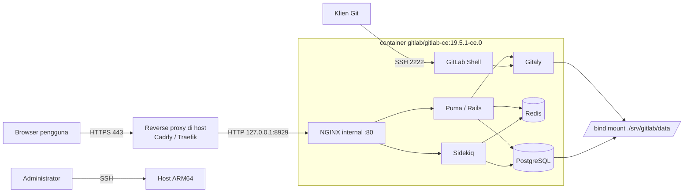

# GitLab CE: Deployment Docker Compose

Laporan Projek Akhir mata kuliah Komunikasi Data dan Jaringan Komputer (KDJK).

| | |
|---|---|
| **Aplikasi web** | GitLab Community Edition (self-hosted) |
| **Metode instalasi** | Docker Compose, image resmi `gitlab/gitlab-ce` |
| **Kelompok** | 5, Paralel P3 |
| **Repositori** | <https://github.com/hamgarian/ProyekKDJK_Kel5_P3> (publik) |
| **URL instance** | <https://gitlab.ilhem.eu.org> (aktif, HTTPS) |
| **Templat laporan** | [templat.md](https://github.com/auriza/komdat-lab/blob/master/templat.md), [projek.md](https://github.com/auriza/komdat-lab/blob/master/projek.md) |

### Anggota Kelompok

| NIM | Nama |
|---|---|
| M0403241083 | Rafid Harsyah Syauqirahman |
| M0403241084 | Melandri Rasya Arindhi |
| M0403241086 | Kevin Daniel Abimanyu Siagian |
| M0403241087 | Ilham Edgar Maulana Goesasi |

---

## Ringkasan Hasil

Instance GitLab CE berjalan di host ARM64 dan dapat diakses publik lewat HTTPS:

| Hal | Hasil |
|---|---|
| Image yang dijalankan | `gitlab/gitlab-ce:19.5.1-ce.0`, varian `linux/arm64` |
| Jalur deployment yang dipakai | Coolify, service Docker Compose langsung ([compose.coolify.yaml](compose.coolify.yaml)) |
| Endpoint | <https://gitlab.ilhem.eu.org> menjawab `HTTP 200` dengan form login GitLab |
| Status service di dalam container | `gitlab-ctl status` menampilkan 10 service berstatus `run:` |
| Reverse proxy dan TLS | Traefik milik Coolify, sertifikat diterbitkan otomatis |

Rincian apa saja yang sudah diverifikasi langsung dan apa yang belum diuji
tercatat di [docs/verifikasi.md](docs/verifikasi.md). Laporan ini tidak
mengklaim hasil uji yang belum dijalankan.

---

## Sekilas Tentang

**GitLab** adalah platform DevOps berbasis web yang menyatukan manajemen
repositori Git, code review, issue tracker, CI/CD, container registry, dan
wiki dalam satu aplikasi. **GitLab Community Edition (CE)** adalah edisi
sumber terbuka berlisensi MIT yang dapat di-*self-host* tanpa biaya lisensi.

Yang membedakan GitLab dari sekadar layanan hosting Git:

- **Satu aplikasi, banyak fungsi.** Repositori, perencanaan (issue, milestone,
  board), code review (merge request), pipeline CI/CD, registry Docker, dan
  GitLab Pages ada dalam satu instalasi, tanpa integrasi pihak ketiga.
- **CI/CD bawaan.** Pipeline didefinisikan di `.gitlab-ci.yml` di dalam
  repositori itu sendiri; runner dapat dijalankan di mesin mana pun.
- **Kedaulatan data.** Seluruh kode, metadata, dan riwayat tersimpan di server
  sendiri. Relevan untuk kode yang tidak boleh keluar dari infrastruktur
  organisasi.
- **Omnibus package.** Satu image/paket sudah memuat seluruh komponen yang
  dibutuhkan: Puma (app server Rails), Sidekiq (background job), PostgreSQL,
  Redis, Gitaly (akses Git), dan NGINX. Tidak perlu merakit tiap komponen.

Pada projek ini GitLab CE dipasang sebagai container Docker tunggal yang
dikelola dengan Docker Compose, dengan TLS diterminasi oleh reverse proxy di
depannya.

## Spesifikasi dan Arsitektur

Seluruh nilai di bawah adalah konfigurasi yang benar-benar dipakai pada host
target, bukan contoh generik.

| Komponen | Konfigurasi yang dipakai |
|---|---|
| Host | `main-instance`, Linux 6.8.0-1058-oracle |
| Arsitektur CPU | **ARM64 (`aarch64`)**, 2 vCPU |
| Memori | 11 GiB RAM + 4 GiB swap |
| Sistem operasi | Ubuntu 22.04 (basis kernel `~22.04.1-Ubuntu`) |
| Docker Engine | 29.0.1 (Community) |
| Aplikasi | `gitlab/gitlab-ce:19.5.1-ce.0` (Omnibus, multi-arch) |
| Komponen dalam container | NGINX, Puma, Sidekiq, PostgreSQL, Redis, Gitaly, GitLab Shell |
| Reverse proxy | Traefik yang dikelola Coolify di host |
| Terminasi TLS | Di reverse proxy, bukan di dalam container |
| Domain | `gitlab.ilhem.eu.org` |
| Port publik | TCP 443 (HTTPS), TCP 2222 (SSH Git) |
| Port internal | container :80, dijangkau Traefik lewat jaringan Docker |
| Persistensi | 3 volume Docker: `gitlab-config`, `gitlab-logs`, `gitlab-data` |

Repositori ini menyediakan dua berkas Compose untuk dua jalur pemasangan yang
keduanya sah, dan isi laporan ini berlaku untuk keduanya:

| Berkas | Jalur | Persistensi | Akses HTTP |
|---|---|---|---|
| [`docker-compose.yml`](docker-compose.yml) | CLI `docker compose` murni, reverse proxy diurus sendiri | 3 bind mount di `./srv/gitlab` | bind `127.0.0.1:8929` |
| [`compose.coolify.yaml`](compose.coolify.yaml) | **jalur yang dipakai pada instance aktif**, ditempel ke service Docker Compose di Coolify | 3 named volume | lewat jaringan Docker ke Traefik |

Pada jalur CLI, port `8929` hanya di-bind ke `127.0.0.1`, sehingga tidak dapat
dijangkau langsung dari internet; satu-satunya jalur HTTP dari luar adalah
melalui reverse proxy yang memegang sertifikat. Pada jalur Coolify, port HTTP
container tidak dipublikasikan ke host sama sekali karena Traefik berada di
jaringan Docker yang sama. Port `2222` harus terbuka langsung pada kedua jalur
karena protokol SSH tidak dapat dilewatkan reverse proxy HTTP. PostgreSQL dan
Redis tidak dipublikasikan sama sekali, keduanya hanya diakses dari dalam
container yang sama.

